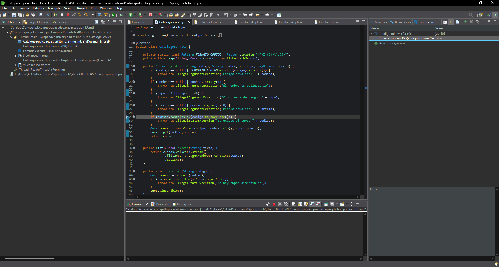
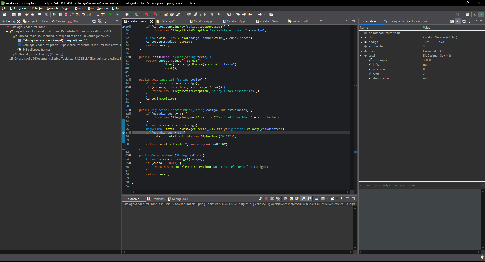
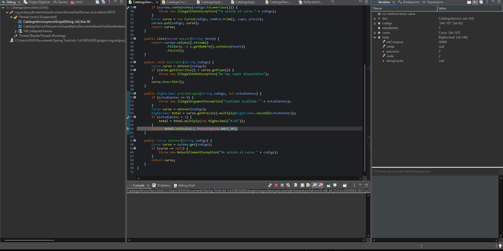

# Catálogo de cursos

API REST en Spring Boot para el catálogo de cursos del instituto. En esta actividad se verifican sus reglas con pruebas JUnit, se localizan los defectos con el depurador y se corrigen sin modificar las pruebas.

## Reglas del catálogo

| Regla | Descripción |
|-------|-------------|
| R1 | El código del curso tiene tres letras mayúsculas, un guion y tres dígitos. Ejemplo: `JAV-101`. |
| R2 | El nombre es obligatorio. No puede estar vacío ni contener solo espacios. |
| R3 | El cupo debe estar entre 5 y 40 estudiantes, ambos incluidos. |
| R4 | El precio debe ser mayor que cero. |
| R5 | No pueden existir dos cursos con el mismo código. |
| R6 | La búsqueda por nombre no distingue mayúsculas de minúsculas. |
| R7 | Un curso no puede tener más inscritos que su cupo. |
| R8 | Las inscripciones grupales de 3 o más estudiantes tienen un 15 % de descuento sobre el total. |

## Cómo ejecutar

Requisitos: Java 17 o superior y Maven (el proyecto incluye el wrapper `mvnw`).

```bash
# Arrancar la API en http://localhost:8080
./mvnw spring-boot:run

# Ejecutar las pruebas
./mvnw test
```

## Registro de defectos

Las pruebas de `CatalogoServiceTest` se ejecutaron sobre el código original, sin modificarlo (commit `test: pruebas de las reglas R1 a R8`). De 33 ejecuciones fallaron 9, que corresponden a los 7 defectos de la tabla. La regla R1 no presentó defectos.

Todas las causas están en `CatalogoService.java`.

| ID | Regla | Prueba que lo detecta | Esperado | Obtenido | Causa y corrección |
|----|-------|-----------------------|----------|----------|--------------------|
| D-01 | R2 | `nombreSoloEspaciosLanzaExcepcion` | Registrar un curso con nombre `"   "` lanza `IllegalArgumentException` | No se lanza ninguna excepción y el curso se registra con nombre vacío | **Causa:** en `registrar` se valida con `nombre.isEmpty()`, que solo detecta la cadena de longitud cero; una cadena con espacios no está "vacía". **Corrección:** usar `nombre.isBlank()`. |
| D-02 | R3 | `cupoDentroDelRangoSeAcepta` (caso cupo = 40) | Un curso con cupo 40 se registra | `IllegalArgumentException: Cupo fuera de rango: 40` | **Causa:** la condición `cupo >= 40` rechaza también el límite superior, que la regla incluye. **Corrección:** cambiar a `cupo > 40`. |
| D-03 | R4 | `precioCeroLanzaExcepcion` | Registrar un curso con precio 0 lanza `IllegalArgumentException` | No se lanza ninguna excepción y el curso se registra con precio 0 | **Causa:** la condición `precio.signum() < 0` solo rechaza los precios negativos; el cero pasa. **Corrección:** cambiar a `precio.signum() <= 0`. |
| D-04 | R5 | `codigoDuplicadoLanzaExcepcion` | Registrar dos veces el código `JAV-101` lanza `IllegalStateException` | No se lanza ninguna excepción y el segundo curso reemplaza al primero | **Causa:** se busca con `cursos.containsKey(codigo.toLowerCase())`, pero los cursos se guardan con el código en mayúsculas (`cursos.put(codigo, curso)`), así que la clave `jav-101` nunca existe. **Corrección:** buscar con la misma clave que se guarda: `cursos.containsKey(codigo)`. |
| D-05 | R6 | `busquedaNoDistingueMayusculas` (casos `java`, `JAVA` y `jAvA`) | La búsqueda encuentra 1 curso (`Java básico`) | La búsqueda encuentra 0 cursos | **Causa:** en `buscar` se compara con `c.getNombre().contains(texto)`, que distingue mayúsculas de minúsculas. **Corrección:** convertir el nombre y el texto a minúsculas antes de comparar. |
| D-06 | R7 | `inscribirConCupoLlenoLanzaExcepcion` | Con cupo 5 y 5 inscritos, una inscripción más lanza `IllegalStateException` | No se lanza ninguna excepción y el curso queda con 6 inscritos | **Causa:** en `inscribir` la condición es `curso.getInscritos() > curso.getCupo()`; con 5 inscritos y cupo 5 es falsa y deja pasar un estudiante de más. **Corrección:** cambiar a `>=`. |
| D-07 | R8 | `precioGrupalAplicaDescuentoDesdeTresEstudiantes` (caso 3 estudiantes) | 3 × 100.00 con 15 % de descuento = `255.00` | `300.00` (sin descuento) | **Causa:** en `precioGrupal` la condición es `estudiantes > 3`, que aplica el descuento desde 4 estudiantes y no desde 3. **Corrección:** cambiar a `estudiantes >= 3`. |

Cada defecto se corrigió en un commit propio, con el mensaje `fix(D-0X): descripción`, sin modificar las pruebas.

## Resultado final

Después de las siete correcciones, `./mvnw test` ejecuta 41 pruebas y todas pasan:

| Clase de prueba | Ejecuciones | Qué verifica |
|-----------------|-------------|--------------|
| `CatalogoServiceTest` | 33 | Reglas R1 a R8 del servicio |
| `CatalogoControllerTest` | 7 | Respuestas HTTP del controlador con `@WebMvcTest` y `@MockitoBean` (201, 200, 400 y 404) |
| `CatalogoApplicationTests` | 1 | La aplicación arranca |

## Evidencia de depuración

Se depuraron dos defectos en Spring Tools for Eclipse, ejecutando la prueba que los detecta con **Debug As → JUnit Test** sobre el código original, antes de corregirlo.

### D-04: código duplicado (R5)

- **Prueba depurada:** `codigoDuplicadoLanzaExcepcion`.
- **Punto de interrupción:** `CatalogoService.java`, línea 29, `if (cursos.containsKey(codigo.toLowerCase()))`.
- **Valores observados (vista Expressions):** `codigo.toLowerCase()` vale `jav-101` y `cursos.containsKey(codigo.toLowerCase())` vale `false`.
- **Conclusión:** el servicio busca la clave en minúsculas (`jav-101`), pero los cursos se guardan con el código tal como llega (`JAV-101`). La clave nunca coincide, por eso el duplicado no se detecta.



### D-07: descuento grupal (R8)

- **Prueba depurada:** `precioGrupalAplicaDescuentoDesdeTresEstudiantes`, en el caso de 3 estudiantes.
- **Punto de interrupción:** `CatalogoService.java`, línea 57, `if (estudiantes > 3)`.
- **Valores observados (vista Variables):** `estudiantes` vale `3` y `total` vale `300.00` (`intCompact = 30000`, `scale = 2`).



Al avanzar un paso (Step Over), la ejecución salta de la línea 57 a la línea 60 (`return`) sin pasar por la línea 58, que es la que aplica el descuento. El `total` sigue en `300.00`.



- **Conclusión:** con 3 estudiantes la condición `3 > 3` es falsa, así que el descuento solo se aplica desde 4 estudiantes. La regla lo exige desde 3.
